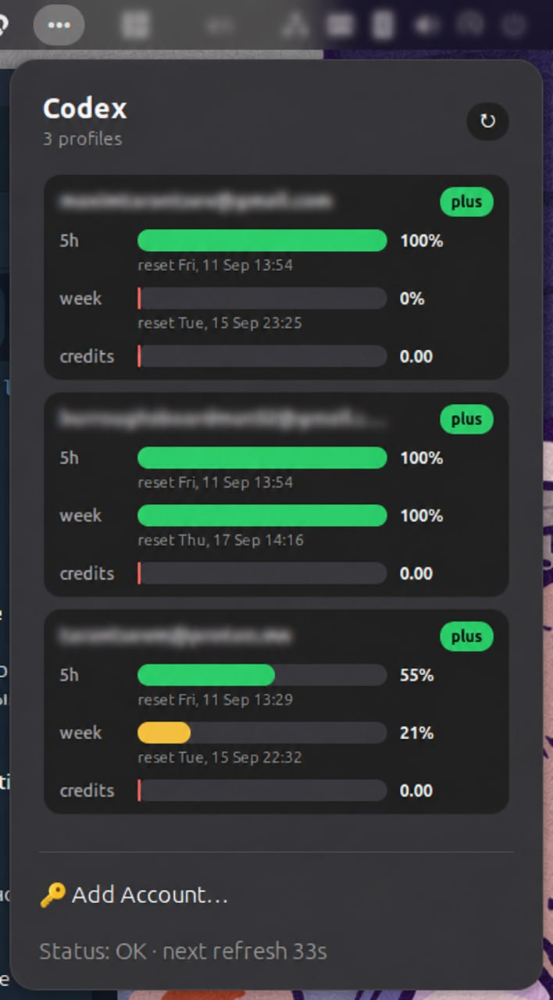
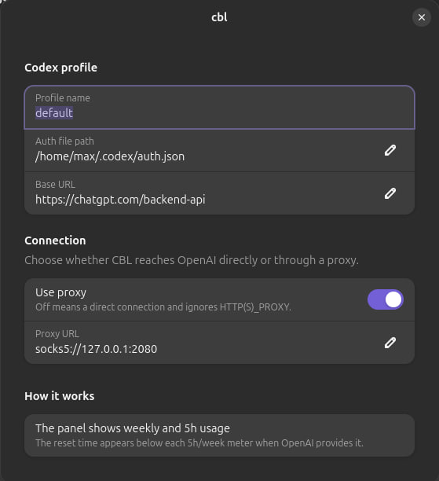

# CBL — Codex Bar for Linux

CBL — это небольшое Linux-приложение, которое показывает лимиты ChatGPT/Codex прямо в верхней панели GNOME.
Оно поддерживает несколько аккаунтов, показывает остаток по 5h / week / credits и позволяет добавлять аккаунты через popup без терминала.

[English README](README.md)

<p align="center">
  
</p>

## Зачем это нужно?

CBL отвечает на простой вопрос: **сколько Codex-лимитов осталось прямо сейчас?**

Что есть:

- компактный индикатор в GNOME top bar;
- popup с отдельной карточкой для каждого аккаунта;
- email/name аккаунта, если они доступны;
- progress bars для 5h, week и credits;
- ручной refresh с защитой от частых кликов;
- автоматический refresh каждую минуту;
- встроенный login через device-code flow;
- локальный HTTP API для панелей и своих интеграций.

CBL **не требует** Codex CLI. Он хранит свои login/account данные в `~/.config/cbl`.

## Что нового в v0.2.44

- В popup теперь видны локальные **дата и время сброса** под каждым лимитом `5h` и `week`, когда OpenAI их передаёт.
- В настройках расширения появилась секция **Connection**: proxy можно включить/выключить и изменить его URL без терминала.
- Если **Use proxy** выключен, CBL подключается напрямую и игнорирует сохранённые и сервисные настройки proxy.

## Быстрые ссылки

### Установка / обновление на Ubuntu GNOME

```bash
curl -fsSL https://raw.githubusercontent.com/hermes-at/cbl/main/install.sh | bash -s -- --systemd --extension
```

Настрой proxy после установки в **GNOME Extensions → cbl → Connection**.

После установки, если нужно:

```bash
systemctl --user restart cbl.service
gnome-extensions enable cbl@codex-limits
gnome-extensions info cbl@codex-limits
```

На GNOME Wayland после установки или обновления CBL нужно выйти из Linux-пользователя и зайти обратно. GNOME Shell часто держит старый код расширения в памяти до перезапуска user session.

Ожидаемое состояние:

```text
State: ACTIVE
```

### Полное удаление

Команда удаляет user service, бинарники, tray autostart, GNOME extension и account/config файлы из `~/.config/cbl`.

```bash
curl -fsSL https://raw.githubusercontent.com/hermes-at/cbl/main/uninstall.sh | bash
```

## Как добавить аккаунт

1. Установи CBL командой выше.
2. Выйди из Linux-пользователя и зайди обратно, особенно если используешь GNOME Wayland.
3. Открой индикатор в GNOME top bar: `•••`.
4. Нажми **Add Account…**.
5. CBL откроет страницу подтверждения OpenAI в браузере.
6. В popup появится одноразовый **Code**.
7. Нажми на строку **Code**, чтобы скопировать код, и вставь его в браузере.
8. После подтверждения в браузере нажми **I confirmed login** в popup.
9. CBL сразу сделает refresh, и карточка аккаунта появится в списке.

Так можно добавить несколько аккаунтов. У каждого будет отдельная карточка.

## Как пользоваться

- Открой индикатор `•••`, чтобы увидеть карточки аккаунтов.
- `5h` показывает остаток короткого окна.
- `week` показывает остаток недельного окна.
- Если OpenAI передаёт время сброса, CBL показывает локальные дату и время сброса под соответствующей строкой `5h` или `week`.
- `credits` показывает кредиты, если аккаунт их отдаёт.
- Кнопка refresh справа сверху запускает ручное обновление.
- Ручной refresh ограничен, чтобы частые клики не спамили запросами.
- В строке status видно, когда будет следующий автоматический refresh.

## Настройки соединения

Открой настройки расширения через GNOME Extensions (нажми шестерёнку рядом с CBL). В секции **Connection** есть переключатель **Use proxy** и поле **Proxy URL**.

<p align="center">
  
</p>

- Включи **Use proxy**, чтобы использовать указанный URL вида `http://`, `https://`, `socks5://` или `socks5h://`.
- Выключи его для прямого соединения. В таком режиме CBL игнорирует сохранённые и сервисные настройки proxy.
- После сохранения обнови popup вручную, чтобы применить выбор сразу; следующее автоматическое обновление также использует его. На GNOME Wayland после установки/обновления расширения выйди из Linux-пользователя и зайди снова, чтобы GNOME Shell загрузил новую версию.

## Локальные команды

```bash
cbl status
cbl status --json
cbl status --waybar
cbl serve --addr 127.0.0.1:18088
```

## Локальный HTTP API

Когда user service запущен, CBL отдаёт:

```bash
curl http://127.0.0.1:18088/api/status
curl http://127.0.0.1:18088/waybar
```

GNOME extension читает этот локальный API.

## Сборка из исходников

Нужно:

- Go 1.22+;
- `bash`, `curl`, `tar`, `python3`;
- GNOME Shell + `gnome-extensions` для GNOME popup;
- опционально: `libayatana-appindicator3-dev` для tray fallback.

Клонировать и собрать:

```bash
git clone https://github.com/hermes-at/cbl.git
cd cbl
go test ./...
go build -o cbl ./cmd/cbl
go build -o cbl-tray ./cmd/cbl-tray
```

Установить из checkout:

```bash
./install.sh --systemd --extension
```

Собрать release artifacts:

```bash
VERSION=v0.0.0-dev ./release/package-release.sh
```

Собрать только zip для GNOME extension:

```bash
./install/ubuntu/package-gnome-extension.sh
```

## Config и файлы

CBL использует только user-level файлы:

- `~/.local/bin/cbl`
- `~/.local/bin/cbl-tray`
- `~/.config/systemd/user/cbl.service`
- `~/.config/cbl/config.json`
- `~/.config/cbl/accounts/*.json`
- `~/.local/share/gnome-shell/extensions/cbl@codex-limits`

Переменные окружения:

- `CBL_AUTH_FILE` — переопределить legacy single-account auth path;
- `CBL_CONFIG_FILE` — переопределить config path;
- `CBL_BASE_URL` — переопределить ChatGPT base URL;
- `CBL_FIXTURE` — offline JSON fixture для тестов/разработки.

## Заметки

- CBL сфокусирован только на видимости Codex usage.
- Основной путь на Ubuntu/GNOME: systemd user service + GNOME Shell extension.
- На не-GNOME desktops можно использовать AppIndicator tray fallback или local HTTP/Waybar output.
